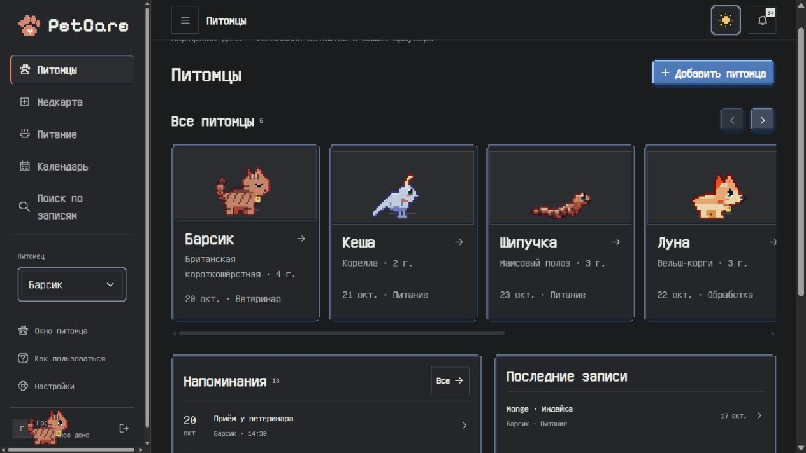

<div align="center">

# 🐾 PetCare

### A little pixel world for everyday pet care

`React` · `Vite` · `Canvas` · `Python` · `SQLite` · `Telegram Bot API`

**[Try the live demo](https://isad4youbro.github.io/petcare/)** · [Русский](#о-проекте) · [How it works](docs/architecture.md)

</div>

PetCare brings medical notes, food observations and upcoming appointments into one pet diary. Build a pixel avatar, explore six fictional pet histories, and open a QR card showing how a lost pet could be returned home.

This repository is a portfolio edition of a team hackathon project. The interface keeps its original pixel-art style; the public demo runs independently of the former event infrastructure.



## О проекте

PetCare — дневник заботы о питомце. В одном месте можно сохранить заключение ветеринара, вспомнить, какой корм подошёл, и спланировать следующий приём. Вместо обычных аватарок здесь пиксельные животные: их можно раскрашивать, подбирать по фото и перетаскивать по экрану.

**[Открыть демо в браузере →](https://isad4youbro.github.io/petcare/)**

### Что попробовать

- Открыть истории Барсика, Кеши, Шипучки, Луны, Плюши и мини-пига Торпедки.
- Добавить питомца и настроить его вид, окрас, рисунок и аксессуары. Редактор поддерживает раскраску и подбор палитры по фото.
- Записать посещение клиники, вакцинацию, вес или наблюдение за питанием.
- Отметить предпочтения и переносимость корма; найти прошлые записи через поиск.
- Создать напоминание, посмотреть календарь и скачать события в формате ICS.
- Открыть QR-метку в профиле питомца, настроить карточку и попробовать форму сообщения о найденном животном.
- Поймать мышкой или пальцем питомца у нижнего края экрана и отпустить.

### Как устроено публичное демо

GitHub Pages размещает только статические файлы. Поэтому в демо **нет регистрации, общей базы данных и отправки Telegram-сообщений**. Дневник хранится в `localStorage` вашего браузера. Обновление страницы сохраняет изменения; «Настройки → Сбросить демо» возвращает исходные истории. Очистка данных браузера удаляет локальные записи.

QR-ссылка открывает демонстрационную карточку. Отчёты о найденном питомце сохраняются только в браузере отправителя и видны там же в разделе «QR-метка → Сообщения». Они **не отправляются настоящему владельцу и не синхронизируются между телефонами**. Личные телефоны и контакты из исходной демонстрации удалены. Не используйте портфолио-демо как настоящую метку на ошейник и не вносите в него чувствительные данные.

Поиск на Pages подбирает записи по теме вопроса и показывает источники. Это локальная логика, а не ответ языковой модели и не медицинская рекомендация.

### Два режима запуска

| | Портфолио | Полное приложение |
|---|---|---|
| Где работает | GitHub Pages / статический хостинг | Собственный Python-сервер |
| Хранение | Браузер посетителя | SQLite на сервере |
| Вход | Не нужен | Имя пользователя и пароль |
| QR-отчёты | Локальная демонстрация | Через API в аккаунт владельца |
| Telegram | Не подключён | Требует собственного токена и запущенного сервера |

## Запуск

Для интерфейса нужны Node.js 24 и npm:

```bash
npm --prefix frontend ci
npm --prefix frontend run build:portfolio
npm --prefix frontend exec vite preview --host 127.0.0.1
```

Для разработки самостоятельного демо:

```bash
npm --prefix frontend run dev -- --mode portfolio
```

Для полного приложения дополнительно нужен Python 3.11+:

```bash
npm --prefix frontend ci
npm --prefix frontend run build
python backend/server.py
```

Откройте `http://127.0.0.1:8000`. Для базового локального запуска внешние сервисы не нужны. Опциональные настройки находятся в `backend/.env.example`. Реальные `.env`, базы и токены не входят в репозиторий. Перед размещением полного приложения в интернете настройте HTTPS, secure cookies, резервное копирование и собственный сервер; встроенный Python HTTP-сервер не заменяет production-платформу.

## Навигация по коду

| Путь | Что находится внутри |
|---|---|
| [`frontend/src/App.jsx`](frontend/src/App.jsx) | Страницы дневника, формы, выбор питомца и календарь |
| [`frontend/src/components`](frontend/src/components) | Редактор, QR-карточка, уведомления, тема и общие элементы |
| [`frontend/src/data.js`](frontend/src/data.js) | Единая точка обращения интерфейса к данным |
| [`frontend/src/portfolio`](frontend/src/portfolio) | Независимое демо: хранилище, вымышленные истории, календарный экспорт |
| [`frontend/vendor/pixel-pets`](frontend/vendor/pixel-pets) | Движок пиксельных питомцев и его тесты |
| [`backend`](backend) | HTTP API, SQLite, сессии, расписания, Telegram и тесты |
| [`docs`](docs) | Архитектура, API, запуск и ограничения |
| [`.github/workflows/pages.yml`](.github/workflows/pages.yml) | Проверки, сборка и публикация демо |

[Понятный гайд по frontend](frontend/README.md) · [Backend](backend/README.md) · [Telegram](docs/telegram.md) · [Безопасность](docs/SECURITY.md)

## Проверки

```bash
npm --prefix frontend test
npm --prefix frontend run check
npm --prefix frontend run build:portfolio
python -m unittest discover -s backend -p "test*.py"
```

Тесты проверяют обработку данных, правила ухода, редактор, поиск животных, работу темы и изоляцию локальных QR-отчётов. Workflow публикует демо после успешной проверки frontend. Браузерные сценарии в `frontend/scripts` предназначены для отдельного запуска с полным сервером.

## Происхождение и сторонние материалы

Основное приложение создано командой на хакатоне PROD 2026; эта публикация сохраняет командное происхождение проекта и добавляет самостоятельный режим для портфолио. История закрытого командного репозитория, рабочие базы и конфигурация мероприятия не публикуются.

У сторонних библиотек и шрифтов собственные лицензии: [уведомления](frontend/THIRD_PARTY_LICENSES.txt), [шрифты](frontend/public/assets/fonts), [движок питомцев](frontend/vendor/pixel-pets). Размещение исходников здесь само по себе не меняет права остальных авторов проекта.
