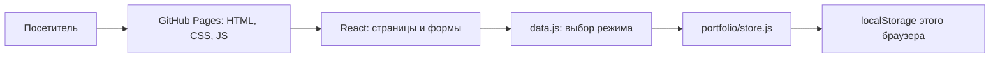
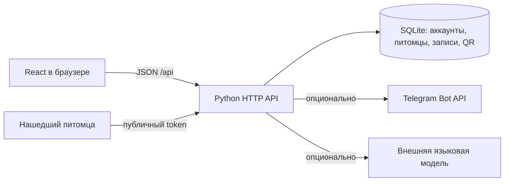

# Архитектура PetCare

## Публичное портфолио

Pages не запускает Python и не хранит общую базу. `VITE_PORTFOLIO=true` выбирает локальное хранилище. `seed.json` содержит только вымышленные данные; при первом чтении даты записей сдвигаются относительно текущего дня. Подключения к старому серверу нет.

## Полное приложение

Вход выдаёт HttpOnly cookie. Сервер проверяет владельца питомца перед чтением и изменением. QR-token указывает на отдельный публичный набор сведений, а не открывает всю медкарту. Отчёт связывается с меткой, питомцем и его владельцем; Telegram-доставка работает только при настройке бота. Чтение QR не означает, что питомец найден.

Два режима используют одни React-компоненты. `data.js` направляет запросы либо в Python API, либо в локальный адаптер; `public-tag.jsx` делает такой же выбор для публичных карточек. Календарный экспорт доступен в обоих режимах.
